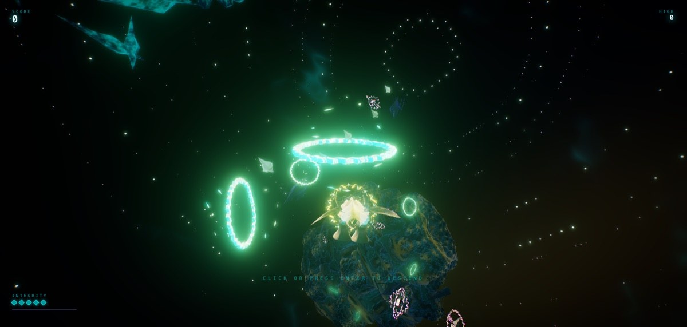

# MACHINE ELF — Hyperspace Descent



A 3D **rail shooter** through DMT hyperspace, built with Three.js **WebGPU + TSL** —
zero external assets. Every mesh is procedural, every texture is math, every sound is
synthesized live with WebAudio.

You pilot the **Orrery** — a blown-glass dragonfly of clockwork rings — down through
six recursive fractal dimensions, fighting the **clockwork elves**: jewelled automata
of neon glass with brass escapements inside, moving in stop-motion ticks.

## Run it

```bash
npm install
npm run dev        # http://localhost:5183
```

Requires a WebGPU browser (Chrome/Edge 113+, Safari 18+). `npm run build` produces a
static bundle in `dist/`.

## Play

| Input | Action |
|---|---|
| **Mouse** | steer the craft (it chases the reticle) |
| **Hold LMB** | sweep the reticle over enemies to paint lock-ons (up to 8) |
| **Release LMB** | fire the homing salvo |
| **Tap LMB** | pulse bolts |
| **Shift / RMB** | boost |
| **B** | overdrive bomb (when the graze meter is full) |
| **WASD / arrows** | keyboard flight |
| Gamepad | left stick fly, RT/A fire, LT/B boost, X bomb |

**Graze** enemy fire (fly within a hair of the magenta darts) to charge the bomb and
build the chain. Three deaths end the run. Each dimension ends in a colossal entity
that assembles itself out of the local mathematics; killing it melts reality into
the next, stranger dimension.

## The six dimensions

1. **Cathedral Glass** — a Mandelbulb continent hangs off the flight path
2. **Verdigris Engine** — Mandelbox corridors you fly *through*
3. **Ultraviolet Choir** — Apollonian gasket voids
4. **Mercury Sutra** — Menger reliquaries, liquid chrome
5. **Ash Vermilion** — self-similar at three scales
6. **Bone Reliquary** — the Kleinian limit set; no up; nothing wants you

## Tech notes

- **Raymarched fractal dimensions** — five analytic distance estimators (TSL,
  `src/world/sdf/`) marched per-fragment on a camera-locked shell, shaded from
  orbit traps, fogged into the palette. Dimension transitions lerp the DE
  parameters — the world *melts* between forms.
- **TSL-only materials** (`src/render/Materials.js`) — transmission+dispersion
  glass, anisotropic aged brass, pixel-constant sacred-geometry etching, and a
  reserved hostile hue (OKLCH 344–358°) that only enemy ordnance may use.
- **Zero-allocation systems** — instanced elves/bullets/particles with
  per-instance state attributes; GPU-parametric particles (CPU cost of 4000 live
  particles: nothing); pooled everything.
- **Escapement animation** — elves think and turn only on tick boundaries
  (`tickEase`/`escapement` in `src/util/enemy-math.js`).
- **Generative score** — a 16th-note lookahead scheduler over six inharmonic
  scales (dorian → whole-tone → octatonic → messiaen mode 3 → alien), with
  dimension-coloured bitcrush, Doppler pitch dips on hitstop, and a ducking
  sidechain glued to impacts.
- **Spring-damper cinematography** — the camera is a second-order system with
  rail-motion feed-forward, trauma² shake, and bank felt *before* the corner.

## Dev harnesses

- `?studio` — specimen orbit inspector (`__studio.subject('wisp')`, `.orbit({az,el,dist})`)
- `?raildebug` — rail frame ribbon/rungs
- `?marchdebug` — fractal raymarch hit/trap views (`__fractal.uDebug.value` 0–5)
- `?tsldebug` — TSL node creation stack traces
- `tools/drive.mjs` — headless Brave CDP driver (screenshots, console capture, input)

## License

Code: MIT (see `LICENSE`). Original procedural assets: CC BY 4.0 (see
`ASSET-LICENSE.md`). Third-party components: see `THIRD_PARTY.md`.
